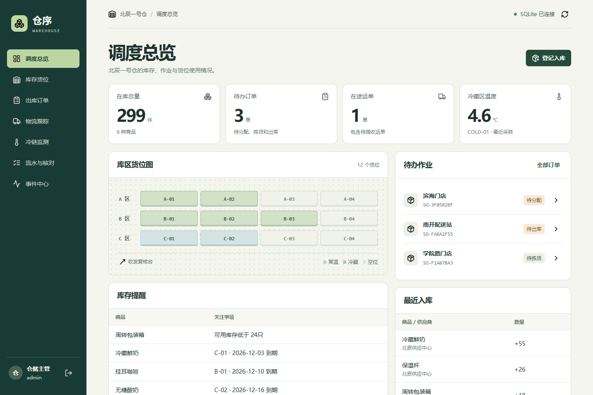

# 仓序 · 智慧仓储与物流协同系统

软件工程课程题目四。仓库作业员可以登记入库、按批次预留、拣货、出库并跟踪签收。主管还可以盘点库存、处理温度告警和重放失败事件，观察员只读。系统按上海时区处理效期，使用同源网页、Express 5 接口和关系数据库。



## 本机启动

Windows 在项目根目录双击「启动系统.cmd」。命令行可用 Node.js 24 和 pnpm 执行以下命令。

```sh
pnpm install --frozen-lockfile
pnpm start
```

浏览器打开 [本机工作台](http://localhost:3210)。演示账号为 `admin`、`operator`、`viewer`，初始口令为 `Warehouse2026!`。SQLite 文件保存在 `data/warehouse.sqlite`，重启后仍可查询业务记录。第一次初始化前设置环境变量 `DEMO_PASSWORD` 可以更改初始演示口令。

## MySQL 标准部署

```sh
docker compose up --build -d
docker compose logs -f app
```

Compose 启动 MySQL 8.4 和应用。网页端口为 3210，数据库客户端连接 `127.0.0.1:3307`，库名和用户名均为 `warehouse`，课程本机默认数据库密码为 `course_db_local`。可在首次启动前通过环境变量 MYSQL_PASSWORD 和 MYSQL_ROOT_PASSWORD 指定口令。命名卷 warehouse-data 保存数据。SQLite 已占用 3210 时可先停止该应用，或设置 APP_PORT=3211 再启动容器。

使用已有 MySQL 服务时，先创建 UTF-8 数据库和仅对该库有建表及读写权限的账号，再设置 DB_DRIVER=mysql、MYSQL_HOST、MYSQL_PORT、MYSQL_DATABASE、MYSQL_USER、MYSQL_PASSWORD 后执行 pnpm start。访问 [连接状态](http://localhost:3210/api/health) 可见正在使用的驱动。MySQL 连接失败时应用报告错误，不会切换到其他库。

## 实验及复验

- [实验三、四报告](docs/智慧仓储实验三四报告.docx) 包含模块实现、实机截图、测试记录和部署步骤。
- [课堂演示与小组任务](docs/演示与协作.md) 给出一笔业务的演示顺序、组员提交和审核入口。
- `pnpm test` 运行组件、HTTP 权限与业务测试，以及 SQLite 备份恢复。MySQL 测试会清空专用的 warehouse_test 测试库，须与业务库分开。
- `pnpm exec playwright install chromium` 后执行 `pnpm test:browser`，通过浏览器验证入库至签收。Windows 可直接使用本机已安装的 Chrome。截图和浏览器结果写入 artifacts。
- `node tools/load-check.mjs` 在隔离的 SQLite 内存库装入一万批次和一万张订单，用 50 个会话测量分页库存查询、创建订单的 P95。
- [验收工作流](https://github.com/chengmar/smart-warehouse-lab/actions/workflows/verify.yml) 在独立环境运行 SQLite、浏览器和真实 MySQL 8.4，并通过 Compose 启动网页与数据库检查入库和对账。

src/domain.js 实现入库、盘点、FEFO 分配与订单状态迁移。src/coordination.js 消费持久化事件、建立运单并核对库存流水。src/db.js 管理 SQLite 和 MySQL 事务。public 提供浏览器工作台。商品、货位在单仓初始化时预置，温度设备及承运商使用本地模拟接口。
